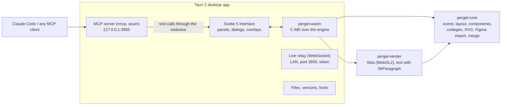

<div align="center">

# Pergel

**A local-first design tool with a Figma-style editor and a built-in MCP server, so AI agents can see a design and build it.**

Rust core · Skia rendering in WebAssembly · Tauri desktop app · Svelte 5 interface

[Features](#features) · [MCP server](#mcp-server-for-ai-agents) · [Import from Figma](#importing-from-figma) · [Performance](#performance) · [Build from source](#building-from-source) · [Architecture](#architecture)


</div>

---

## What it is

Pergel is a vector design tool that works the way Figma does: frames, components, auto layout,
variables, prototyping and Dev Mode-style code. It runs on your machine and keeps your files on
your disk.

It is built for working with AI coding agents. While the app is open, it serves an MCP server on
`127.0.0.1`. Claude Code, Claude Desktop, Cursor or any other MCP client can read the open design,
get production-ready reference code with the real icon and image files, compare its implementation
with the design pixel by pixel, and edit the design itself.

> **Status:** early development (0.1). It is a working editor, but expect rough edges. It is
> developed and tested on Windows 11. Tauri builds for macOS and Linux too, but those builds
> haven't been tested yet.

### Why another design tool?

- **AI agents tend to guess.** Given a design, they redraw icons as their own inline SVG, swap in an
  icon library and leave image placeholders. Pergel's MCP answers come with every icon and image as
  a deduplicated file, rules that say what to reuse, and a pixel diff (`compare_to_design`) to check
  the result.
- **Local first.** Files live on your disk. There is no account, and the MCP server never leaves
  `localhost`.
- **It's fast.** The engine is Rust compiled to WebAssembly, drawing with Skia on WebGL2: 100,000
  layers stay interactive (see [Performance](#performance)).
- **Bring your Figma files.** Paste a figma.com link and it opens as a Pergel file, with vectors,
  images, auto layout, components, variants, variables and prototypes.

---

## Features

### Canvas and drawing

| | |
|---|---|
| Frames, groups, sections, slices | Frame presets; Shift+S sections with titles; S slices for export |
| Shapes | Rectangle, ellipse, line, arrow, polygon, star, sticky notes |
| Vectors | Pen (P), pencil (Shift+P) with smoothing, vector edit mode, boolean operations, flatten, outline stroke, offset path, simplify vertices, join paths (Ctrl+J) |
| Paint | Solid, linear/radial/angular/diamond gradients, image fills (fill, fit, crop, tile) with exposure, contrast, saturation, temperature, tint, highlights and shadows; several fills per layer |
| Strokes | Inside, center or outside; dashes; per-side weights; end points (line arrow, triangle, reversed triangle, circle, diamond) |
| Effects | Drop and inner shadows, layer and background blur |
| Text | Variable fonts (system fonts and Fontsource), mixed styles in one layer, links, auto width or height or fixed, bulleted and numbered lists, OpenType features (tabular numbers, ligatures, small caps, slashed zero), type on a path |
| Layout | Auto layout (horizontal, vertical, wrap, grid) with taffy, constraints, layout grids, rulers and guides, smart guides and snapping, Alt-hover measurement, tidy up, pack, Scale tool (K) |
| Masks and clipping | Use as mask, clip content |

### Design systems

- **Components and variants:** instances follow the main component and keep their overrides;
  component sets; swapping variants keeps the text typed into an instance.
- **Component properties:** boolean, text and instance swap, defined on the component, linked on
  its layers and set per instance.
- **Variables with modes** (colors, numbers, strings, booleans, aliases), and text, color and
  effect styles.
- **Team libraries:** publish a file's components; use them in any file; accepting an update moves
  the instances over and keeps their text.
- **Code Connect:** map components to the components in your codebase. Generated code then uses
  `<Button variant="ghost" label="Buy now" />` with the right import. Suggestions come from
  scanning your project (`.tsx`, `.jsx`, `.vue`, `.svelte`, cva variants).

### Prototyping

- On click, while hovering, or after a delay; navigate, back, open a URL, with transitions.
- Overlays (position, close on outside click, darkened background), close overlay.
- **Interactive components** (change to another variant) and **variables in prototypes**:
  set variable, conditionals (if/else), scroll to.
- Overflow scrolling, played in **Present** (Ctrl+Alt+Enter), which renders every state without
  touching the document.

### Collaboration and files

- **Live sessions** on the local network: other people's cursors with their names, and a merge per
  top-level frame. People editing different frames at the same time keep all of their work; when two
  change the same frame at once, everyone ends up with the later change, and work done while
  disconnected merges in on rejoining the same link. Only the changed frames are sent, and Undo
  reverts your own changes, not the others'. Click someone's avatar to follow their view (pages
  included), or "Spotlight me" to have everyone follow yours. The link carries a random 128-bit
  token.
- **Comments:** threads pinned to layers or to the canvas, with replies and resolve. They are saved
  in the file.
- **Branching:** create a branch, review its changes (added, changed or deleted frames), and merge
  it back into the main file.
- **Version history:** named versions, plus an autosave version every 10 minutes.
- **Multiple pages, tabs, a home screen** with recents, drafts, starred and trash.
- **Export:** PNG, JPG, SVG and PDF; a slide deck as one PDF; frames as a static HTML site; copy as
  PNG, SVG, text or code.

### Plugins

- Pergel plugins are JavaScript in a sandboxed Web Worker with a small async `pergel` API. Each run
  is one undo step.
- **Figma plugins:** import a plugin's folder (`manifest.json`, its main script and UI). Pergel
  provides a `figma` API (nodes and their properties, `create*`, `selection`, `findAll`, `showUI`
  with `pluginMessage`, `clientStorage`, `exportAsync`). Figma's own "Rectangle Creator" sample runs
  unchanged; plugins that need parts of the API Pergel doesn't have yet won't. As in Figma, a
  plugin's code runs in a separate JavaScript engine (QuickJS) with no access to the app, the disk
  or the network, with capped memory and a time limit; its UI runs in a sandboxed iframe.

### Dev Mode features

- A code panel with React + Tailwind or HTML + CSS. Variables come out as CSS custom properties,
  constraints as responsive positioning, auto layout as flex and grid. Assets come out as files.
- Ready-for-dev status, annotations, measurements.

---

## MCP server for AI agents

The desktop app runs an MCP server (Streamable HTTP) at `http://127.0.0.1:3855/mcp` while it is
open. It listens only on the loopback interface, so other machines can't reach it.

### Connect

**Claude Code:**

```sh
claude mcp add --transport http pergel http://127.0.0.1:3855/mcp
```

Main menu → *Copy Claude Code setup command* copies the same line. For other clients, add an HTTP
MCP server with the URL above.

### Tools (34) and prompts

Tool names follow Figma's Dev Mode MCP server, so prompts written for Figma work here too.

| Group | Tools |
|---|---|
| **Read the design** | `get_metadata`, `get_screenshot`, `get_design_context`, `get_variable_defs`, `get_selection`, `get_components`, `get_pages`, `search_design_system` |
| **Design to code** | `download_assets`, `compare_to_design`, `get_code_connect_map`, `add_code_connect_map`, `get_code_connect_suggestions` |
| **Edit the design** | `create_nodes`, `update_node`, `delete_nodes`, `select_nodes`, `create_instance`, `set_variant`, `set_variables`, `bind_variable`, `set_interactions`, `switch_page`, `run_script` (JavaScript against the document, like Figma's `use_figma`) |
| **Build content** | `search_icons` (200,000+ Iconify icons, placed as real vectors), `generate_diagram` (Mermaid flowchart → editable shapes and arrows), `create_new_file` |
| **Files and teams** | `import_figma` (a shared figma.com link), `get_libraries`, `use_library_component`, `publish_library`, `get_comments`, `add_comment`, `resolve_comment` |
| **Prompts** | `implement_design`, `design_screen` |

The full reference, with the node spec format, is in [docs/mcp.md](docs/mcp.md).

### How the code ends up matching the design

1. **Assets are files.** `get_design_context` finds every icon, logo, illustration and image fill,
   deduplicates them, names them after their layers, and writes them into your project
   (`assets_dir`) or serves them at `/assets/<file>`.
2. **The reference code already uses them**, through `` or CSS backgrounds, so there is
   nothing left to redraw.
3. **Explicit rules** start every answer: assets are final, values are exact, text is verbatim.
4. **Tokens, not magic numbers:** bound properties come out as `var(--color-primary, #7c3aed)`.
5. **Your own components** through Code Connect, with their props and imports.
6. **Verification:** `compare_to_design` returns a match score, a side-by-side image with the
   differences in red, and the layers where they are.

### Example session

> **You:** Implement the selected frame in `src/pages/Checkout.tsx`. Use our components.
>
> **Claude:**
> 1. `get_code_connect_suggestions` → maps *Button* and *Input* to `@/components/ui`.
> 2. `get_design_context` with `assets_dir: "public/assets"` → code, 6 asset files, rules.
> 3. Writes the page, takes a screenshot of it, then calls `compare_to_design` → 97.8% match. It
>    fixes the 2 px gap it reports.

> **You:** Here is the flow: `graph TD; A[Cart] --> B{Signed in?} …` Draw it, and reply to the
> open comments when you're done.
>
> **Claude:** `generate_diagram` → `get_comments` → `add_comment` / `resolve_comment`.

---

## Importing from Figma

Pergel reads Figma files through Figma's REST API, with your personal access token. The token is
stored only on your computer and only sent to `api.figma.com`.

1. In Figma: *Settings → Security → Personal access tokens*. Create one with the *File content:
   read* scope.
2. In Pergel, either:
   - **paste a figma.com link onto the canvas** (Ctrl+V); the import dialog opens with it, or
   - choose *File → Import from Figma* and paste the link.
3. Paste the token and tick *Remember*. From then on, pasting a link starts the import right away.

A link to a single frame (`?node-id=…`, Figma's *Copy link*) imports just that frame. The file must
be readable with your account. An agent can import a link you were sent with `import_figma`.

**What comes over:** pages, frames and groups, vectors (exact geometry), image fills, text with
mixed styles, auto layout, constraints, layout grids, effects, strokes (dashes, per-side weights),
components, instances, variants, component properties, prototype links (overlays and variant
changes included), list styles and OpenType features. Figma's REST API doesn't return a file's
local variables or its plugins.

---

## Performance

These were measured on Windows 11 with an RTX 3080 and 8 logical cores, using the release WASM
build in Chromium (ANGLE/D3D11) on a 744×680 canvas. Frame times include GPU time (`gl.finish()`)
and are medians of three rounds after a warm-up.

| Layers | Build scene | Whole scene in view | Zoomed in 4× |
|---:|---:|---:|---:|
| 1,000 | 1 ms | 1.2 ms/frame (≈826 fps) | 0.16 ms |
| 10,000 | 13 ms | 8.9 ms/frame (≈113 fps) | 1.3 ms |
| 100,000 | 139 ms | 22 ms/frame (≈45 fps) | 11.6 ms (≈86 fps, 10k visible) |

| | Pergel | Figma desktop 126.9 |
|---|---|---|
| Install size | ≈30 MB (debug build; release is smaller) | 365 MB per version |
| Memory with a file open | 528 MB with a small file; 589 MB with 10,000 layers (most of it the WebView2 runtime) | ≈3 GB with a restored session |
| Memory ceiling | WASM heap grows as needed (up to 4 GB) | 2 GB per file tab |
| Open a 10,000-layer file | 43–64 ms (3.75 MB JSON) | — |
| Hit test on 100,000 layers | < 1 µs | — |

The full method, caveats and a feature-by-feature comparison are in
[docs/figma-vs-pergel.md](docs/figma-vs-pergel.md). The Figma rows describe one session on the same
machine, not a controlled benchmark.

---

## Architecture



- **`crates/pergel-core`** is plain Rust with no graphics. It holds the scene graph, undo history,
  auto layout (taffy), components and overrides, variables, styles, prototypes, code generation,
  SVG export, SVG import (usvg), the Figma converter, the Mermaid diagram layout and the three-way
  document merge. Its unit tests are fast.
- **`crates/pergel-render`** draws the scene with Skia: a level-of-detail mesh when zoomed out,
  detailed shapes when zoomed in. Text uses SkParagraph with variable fonts; type on a path uses
  RSXform.
- **`crates/pergel-wasm`** compiles both to `wasm32-unknown-emscripten` and exposes a C ABI. It
  also implements the agent tools, so the MCP server and plugins share one code path.
- **`src-tauri`** is the desktop shell: file storage, version history, system fonts (fontdb), the
  MCP server, the live-collaboration relay, and the codebase scanner for Code Connect.
- **`src/`** is the Svelte 5 interface. It talks to the engine through `src/lib/engine.ts`.

### Repository layout

```
crates/
  pergel-core/      scene, layout, components, codegen, Figma import, merge…
  pergel-render/    Skia renderer and text
  pergel-wasm/      WebAssembly build (C ABI, agent tools)
src/
  lib/              editor state, engine bindings, MCP bridge, plugins, live, libraries
  lib/ui/           Svelte components (canvas, panels, dialogs)
src-tauri/          desktop app: files, fonts, MCP server, live relay, code scanner
scripts/            build-wasm.mjs
public/engine/      the built engine (pergel-wasm.js + .wasm)
docs/               MCP reference, Figma feature inventory, comparison
```

### The `.pergel` file format

A `.pergel` file is JSON (`"format": "pergel/document"`, `"version": 2`). It holds:

- pages, with the layer trees and the ruler guides;
- images, embedded as base64 and keyed by content hash;
- variables (collections and modes) and styles;
- comments;
- branch information, for branch files.

The same format is used for the clipboard, version history and live-session sync.

---

## Building from source

### Requirements

| Tool | Version used | Notes |
|---|---|---|
| Rust | 1.99 (edition 2024) | `rustup target add wasm32-unknown-emscripten` |
| Emscripten (emsdk) | 6.0.12 | Expected at `../tools/emsdk` next to the repo, or set `EMSDK`. On networks where Python's SSL fails, install with `EMSDK_USE_CURL=1`. |
| Node.js | 20+ | npm |
| Tauri 2 prerequisites | — | [tauri.app/start/prerequisites](https://tauri.app/start/prerequisites/). On Windows, WebView2 and the MSVC build tools. |

### Steps

```sh
npm install

# Build the engine (WebAssembly) into public/engine/
npm run wasm          # release build (optimized, a few minutes)
npm run wasm:dev      # dev build (faster)

# Run the desktop app (Vite on 127.0.0.1:1430, then the Tauri window)
npm run tauri dev

# Or only the web interface in a browser (no MCP server, no file system)
npm run dev
```

The browser-only mode keeps files in `localStorage`. It is useful for working on the interface,
but the MCP server, system fonts and LAN sessions need the desktop app.

### Checks

```sh
cargo test -p pergel-core     # core unit tests
npm run check                 # svelte-check / TypeScript
cargo check -p pergel         # the desktop app
```

### Release build

```sh
npm run wasm
npm run tauri build
```

### Build notes

- `scripts/build-wasm.mjs` points the Emscripten toolchain at `emcc`/`em++`. It links with `em++`,
  because the prebuilt Skia needs libc++.
- `skia-safe` keeps its default features (prebuilt binaries), plus `gl` and `textlayout`.
- The prebuilt Skia's FreeType uses JS-style `setjmp`. `crates/pergel-wasm/c/sjlj.c` provides the
  `invoke_*` trampolines it imports. Don't add `-sSUPPORT_LONGJMP=emscripten`.
- In dev builds the console exposes `window.__pergel` (the editor) and `window.__pergelTool` (run
  any MCP tool), which helps when testing by hand or from a script.

---

## Keyboard shortcuts (selection)

| Action | Keys | Action | Keys |
|---|---|---|---|
| Move / Scale / Hand | V / K / H | Quick actions | Ctrl+K |
| Frame / Section / Slice | F / Shift+S / S | Find layers / Find and replace | Ctrl+F / Ctrl+H |
| Rectangle / Ellipse / Line / Arrow | R / O / L / Shift+L | Group / Frame selection / Ungroup | Ctrl+G / Ctrl+Alt+G / Ctrl+Shift+G |
| Pen / Pencil / Text / Comment | P / Shift+P / T / C | Auto layout | Shift+A |
| Create component | Ctrl+Alt+K | Join paths | Ctrl+J |
| Tidy up | Ctrl+Alt+Shift+T | Outline stroke | Ctrl+Shift+O |
| Rulers / Layout grids | Shift+R / Shift+G | Measure | hold Alt |
| Present | Ctrl+Alt+Enter | Hide interface | Ctrl+\ |
| Place image | Ctrl+Shift+K | Version history | Ctrl+Alt+S |

---

## Plugins

```js
// A Pergel plugin: Tools → Plugins → +. Each run is one undo step.
const { selection } = await pergel.selection();
for (const layer of selection) {
  await pergel.update(layer.id, { radius: 12 });
}
pergel.notify(`Rounded ${selection.length} layers`);
```

The `pergel` API:

- `selection()`, `metadata(id)`, `node(id)`
- `create(specs, parentId)`, `update(id, props)`, `remove(ids)`, `select(ids)`
- `designContext(id)`, `screenshot(id)`, `searchIcons(query)`, `variables()`, `notify(text)`
- `tool(name, args)`, for any MCP tool

To run a **Figma plugin**, use the puzzle button in the Plugins panel and pick the plugin's folder.

---

## Limitations and roadmap

**Not yet:**

- Cloud storage and accounts.
- Multiplayer over the internet. Live sessions run on the local network, and merging is per
  top-level frame, not per property.
- Widgets. Figma plugins work only within the supported API.
- Slots in component properties; video in prototypes.
- FigJam, Slides and Sites as separate products. Pergel has sticky notes and Mermaid diagrams,
  16:9 decks with PDF export, and HTML publishing, inside the design editor.
- Figma's AI features. Pergel's AI story is the MCP server.

**Next:**

- Per-property merging.
- Shared libraries across machines.
- macOS and Linux test builds.
- A wider Figma plugin API.

---

## Contributing

Issues and pull requests are welcome. Before a pull request, please:

1. Run `cargo test -p pergel-core` and `npm run check`.
2. Keep engine logic in `pergel-core`, which has no graphics and has unit tests. Keep drawing in
   `pergel-render` and the C ABI in `pergel-wasm`.
3. Add or update the MCP docs when a tool changes.

## Acknowledgements

- [Skia](https://skia.org) via [skia-safe](https://github.com/rust-skia/rust-skia)
- [taffy](https://github.com/DioxusLabs/taffy)
- [usvg](https://github.com/linebender/resvg)
- [rmcp](https://github.com/modelcontextprotocol/rust-sdk)
- [Tauri](https://tauri.app), [Svelte](https://svelte.dev)
- [Iconify](https://iconify.design), [Lucide](https://lucide.dev)
- [Inter](https://rsms.me/inter/), [Fontsource](https://fontsource.org)

## License

[MIT](LICENSE)

Pergel is an independent project and is not affiliated with Figma, Inc. "Figma" is a trademark of
Figma, Inc.; it is mentioned here only to describe import and compatibility features.
